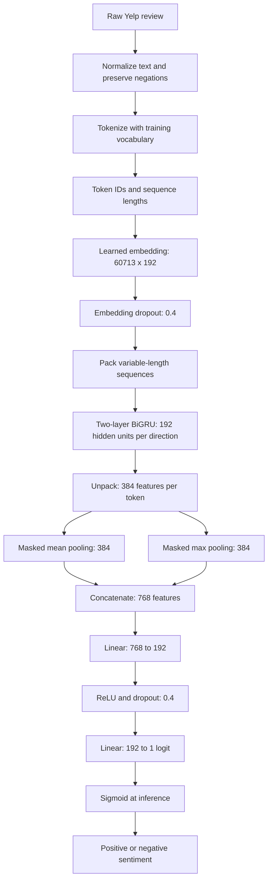

# Yelp Sentiment Benchmark

**Binary sentiment classification with GRU and bidirectional recurrent neural networks in PyTorch.**

Built a text preprocessing, training, and evaluation pipeline for Yelp reviews, comparing three recurrent architectures with embeddings learned from scratch. The strongest model—a two-layer bidirectional GRU with masked mean/max pooling—achieved **94.61% test accuracy**, **0.9461 macro-F1**, and **0.9881 ROC-AUC** on **38,000 reviews**.

[Training notebook](notebooks/benchmark_sentiment.ipynb) · [Model settings](configs/model_configs.json) · [Full metrics](reports/metrics.csv) · [Error analysis](reports/failure_analysis.md) · [Setup](SETUP.md)

## What I built

- **Text preprocessing:** contraction expansion, normalization, negation-aware stopword filtering, tokenization, and a vocabulary learned only from training reviews.
- **Three PyTorch classifiers:** a single-layer GRU baseline, a bidirectional GRU, and a stacked BiGRU with mean/max pooling and an MLP classification head.
- **Variable-length sequence handling:** padded token batches, packed recurrent sequences, and masking that excludes padding from pooling.
- **Training and model selection:** learned embeddings, dropout, AdamW optimization, binary cross-entropy with logits, and validation-based checkpoint selection.
- **Evaluation beyond accuracy:** precision/recall/F1, ROC-AUC, PR-AUC, Matthews correlation coefficient, calibration, bootstrap confidence intervals, paired McNemar tests, and robustness by review length and negation.
- **Failure analysis:** review of 20 errors covering confident false positives, confident false negatives, near-threshold cases, and slice-specific failures.

## Architecture

The main architecture combines a two-layer BiGRU with masked mean/max pooling. The simpler GRU and BiGRU models provide comparison points for accuracy, calibration, parameter count, and training cost.



During training, `BCEWithLogitsLoss` consumes the output logit directly. Sigmoid converts it to a probability during evaluation. The baseline uses its final hidden state; the single-layer BiGRU concatenates its final forward and backward hidden states.

| Configuration | GRU | BiGRU | Stacked BiGRU + MeanMax |
|---|---:|---:|---:|
| Embedding dimension | 64 | 128 | 192 |
| Hidden dimension per direction | 64 | 128 | 192 |
| Recurrent layers | 1 | 1 | 2 |
| Bidirectional | No | Yes | Yes |
| Dropout | 0.2 | 0.3 | 0.4 |
| Batch size | 256 | 256 | 512 |
| Learning rate | 0.001 | 0.0005 | 0.0003 |
| Training epochs | 3 | 5 | 8 |
| Selected epoch | 3 | 5 | 7 |
| Parameters | 3,910,657 | 7,969,665 | 12,915,265 |

No pretrained embeddings or pretrained language models are used. Architecture, embedding size, training duration, and hyperparameters vary together, so this is not a controlled ablation of bidirectionality or depth alone.

## Dataset and preprocessing

The benchmark uses **Yelp Polarity** (`fancyzhx/yelp_polarity`) for positive/negative review classification.

| Setting | Value |
|---|---:|
| Training reviews | 504,000 |
| Validation reviews | 56,000 |
| Test reviews | 38,000 |
| Vocabulary size | 60,713 |
| Maximum sequence length | 256 tokens |
| Minimum token frequency | 5 |
| Random seed | 171 |

The official training split is divided into training and validation subsets; the official test split is unchanged. Each split is class-balanced. Vocabulary construction uses training data only. Padding and unknown tokens have dedicated IDs. Reviews that become empty after preprocessing receive an unknown token rather than being dropped.

[Preprocessing settings](configs/preprocessing_config.json)

## Test results

These measurements are from the saved experiment metrics.

| Model | Accuracy | Macro-F1 | ROC-AUC | PR-AUC | MCC |
|---|---:|---:|---:|---:|---:|
| GRU | 94.28% | 0.94276 | 0.98660 | 0.98696 | 0.88557 |
| BiGRU | 94.46% | 0.94460 | 0.98642 | 0.98614 | 0.88929 |
| **Stacked BiGRU + MeanMax** | **94.61%** | **0.94613** | **0.98814** | **0.98852** | **0.89229** |

The stacked model made **128 fewer errors** than the baseline: 2,047 versus 2,175. That is **0.337 percentage points higher accuracy** and **5.89% fewer errors**, with a larger model and longer training time.

### Uncertainty and calibration

- **Accuracy 95% bootstrap interval:** 94.397%–94.850% for the stacked model, using 1,000 resamples and seed 171.
- **Paired McNemar test:** baseline versus stacked model has an exact p-value of approximately 0.000297 on the same test examples.
- **Calibration tradeoff:** the baseline has the lowest 15-bin expected calibration error, 0.01146 versus 0.02112. The stacked model has the lower Brier score, 0.04172 versus 0.04345. Calibration conclusions depend on the metric.

[Confidence intervals](outputs/bootstrap_95ci.csv) · [Paired comparisons](outputs/mcnemar_tests.csv) · [Slice robustness](outputs/slice_robustness_metrics.csv)

### Stacked model confusion matrix

| Actual / predicted | Negative | Positive |
|---|---:|---:|
| Negative | 18,045 | 955 |
| Positive | 1,092 | 17,908 |

## GPU training and efficiency

**GPU:** NVIDIA GeForce **RTX 4090**, approximately 24 GB VRAM.  
**CPU:** AMD Ryzen 9 7950X, 16 cores.

| Model | Training time | Training reviews/sec | Recorded peak GPU memory |
|---|---:|---:|---:|
| GRU | 2.83 min | 9,302 | 0.14 GB |
| BiGRU | 8.42 min | 5,195 | 0.39 GB |
| Stacked BiGRU + MeanMax | 26.80 min | 2,566 | 1.43 GB |

These are recorded measurements, not performance guarantees on other hardware. Memory figures describe the logged training measurement, not total installed VRAM or whole-system memory use.

## Error analysis and limitations

The error review identifies mixed sentiment, temporal updates, entity confusion, complex negation, and long narratives as recurring challenges. The stacked model's macro-F1 is 0.94734 on short reviews and 0.93858 on long reviews.

The 256-token limit can discard later context. This is a balanced binary review benchmark; performance on neutral reviews, other domains, or production traffic has not been established. The model is not presented as a deployed service.

The stacked model's full raw training log was overwritten during an accidental rerun; its eight-epoch history remains available. See the [training-log note](reports/training_log_note.md). Model weights and datasets are not bundled. The notebooks were reorganized and their outputs cleared; the edited notebooks have not been rerun end-to-end.

## Run locally

Follow [SETUP.md](SETUP.md) to create an environment, install dependencies, and prepare the data. From the repository root, after setup:

```powershell
cd notebooks
python -m jupyterlab
```

Open `benchmark_sentiment.ipynb` and review setup cells before running. Some cells require CUDA and write fixed output filenames; use a fresh working copy for new experiments. `requirements.in` is a dependency list, not a verified environment lock.

## Repository structure

```text
notebooks/
  benchmark_sentiment.ipynb
configs/
  model_configs.json
  preprocessing_config.json
reports/
  metrics.csv
  results.md
  failure_analysis.md
  training_log_note.md
outputs/
  training/
  bootstrap_95ci.csv
  mcnemar_tests.csv
  slice_robustness_metrics.csv
SETUP.md
requirements.in
```

## Technical skills demonstrated

**Python · PyTorch · Natural Language Processing (NLP) · Deep Learning · Sentiment Analysis · Text Classification · Recurrent Neural Networks (RNNs) · GRU · Bidirectional GRU · Word Embeddings · Sequence Modeling · Feature Engineering · GPU Training · Model Evaluation · Statistical Testing · Probability Calibration · Error Analysis**

